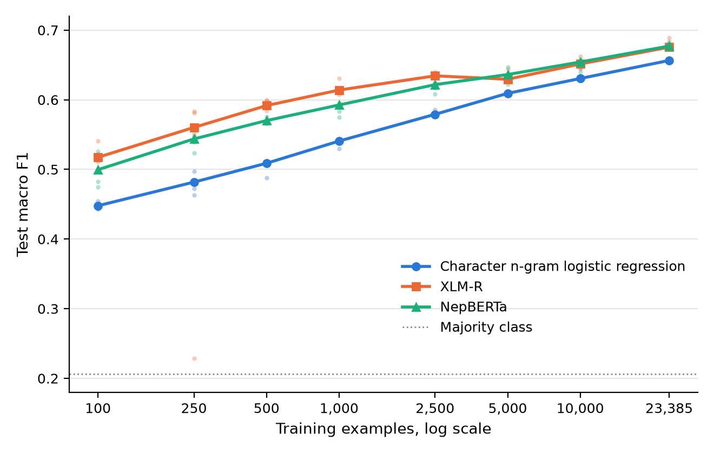
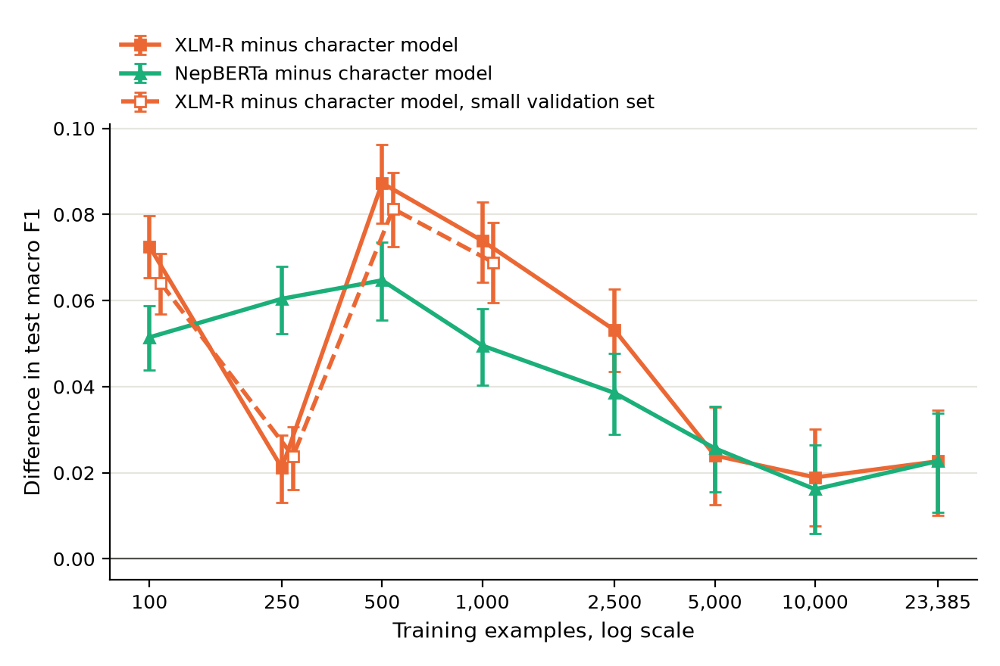

# How Much Data Do Nepali Sentiment Models Need? Character Baselines versus Multilingual and Language-Specific Transformers

Kriti Dahal and Gaurab Khadka

Independent research project. Technical report, October 2026.

## Abstract

We compare a tuned character n-gram logistic regression with a fine-tuned multilingual transformer (XLM-R base) and a Nepali monolingual encoder (NepBERTa) for three-class sentiment classification of Nepali tweets. The data are the NepCOV19Tweets corpus released by Sitaula et al. (2021). Training sets range from 100 examples to the full training set of {n_full} examples, with repeated label-stratified subsampling, and all models are trained on identical subsamples. We evaluate under a split that keeps near-duplicate tweets in the same partition. XLM-R outperforms the character model at every training size tested. The mean paired macro F1 difference ranges from {xlmr_diff_min} to {xlmr_diff_max}, and every 95% interval excludes zero after Holm correction. The advantage is largest at a few hundred to a few thousand examples and narrows to {xlmr_diff_full} at full size. The character model therefore has no small-data regime of superiority on this task, down to 100 examples. A sensitivity analysis in which model selection uses a validation set scaled to the training budget leaves the conclusion unchanged. {abstract_nepberta} Random splitting, which places near-duplicate tweets on both sides of the evaluation, raises the character model's macro F1 from {leak_grouped} to {leak_random}. We release code, split identifiers and predictions. We do not redistribute tweet text.

## 1 Introduction

For low-resource languages, practitioners often have a few hundred to a few thousand labeled examples. Character n-gram linear models are cheap, robust to spelling variation, and frequently competitive in this range, so the choice between such a model and a fine-tuned pretrained transformer is not obvious. Published comparisons usually report a single training-set size. That cannot show where, or whether, the ranking changes as the amount of labeled data grows.

This report studies that question for Nepali sentiment classification. The primary research question (RQ1) is: at what training size, if any, does fine-tuned XLM-R reliably outperform a character n-gram logistic regression tuned on the same data? Two secondary questions follow. RQ2 asks whether a Nepali monolingual encoder (NepBERTa) changes the answer. RQ3 asks how much near-duplicate leakage under random splitting inflates measured performance.

The contributions are:

1. a paired learning-curve comparison with repeated subsampling, a pre-specified crossover criterion, and test-sampling uncertainty
2. a leakage-controlled split of NepCOV19Tweets that groups near-duplicate tweets, with an estimate of the inflation caused by random splits
3. a sensitivity analysis on the size of the validation set used for model selection

We do not introduce a new dataset. All labels are those of Sitaula et al. (2021).

## 2 Related Work

Nepali sentiment analysis. NepCOV19Tweets (Sitaula et al., 2021) is a three-class corpus of Nepali tweets about COVID-19. Its authors report that four annotators labeled each tweet, with majority voting and no published agreement statistic. Their models are CNNs on fastText and hand-designed features, evaluated over ten random 70/30 splits; the best reported accuracy is 68.7%. Later work on the same corpus combines TF-IDF and fastText features with classical classifiers (Shahi et al., 2022) and fine-tunes BERT-based models. Those studies use random splits and mostly report accuracy, so their numbers are not directly comparable with ours.

Code-mixed and Romanized Nepali. Pahari and Shimada (2023) annotated 10,702 Nepali-English YouTube comments. They found TF-IDF with an SVM (macro F1 0.68) roughly on par with mBERT (0.68), XLM-R (0.65) and MuRIL (0.70) at that size. Patel et al. (2026) show that transliterating Romanized Nepali to Devanagari improves mBERT and MuRIL. Those datasets were not obtainable from an authoritative public source at the time of this study (see `docs/related_datasets.md`), so script and transliteration questions are out of scope here.

Pretrained models. XLM-R (Conneau et al., 2020) includes Nepali in its CC-100 pretraining data. NepBERTa (Timilsina et al., 2022) is a BERT model pretrained on Nepali news text.

## 3 Data

### 3.1 Source and terms

We obtained NepCOV19Tweets from the Kaggle record maintained by one of the dataset's authors. The record's description asks users to cite the paper and states no other terms. The tweets come from Twitter, and the release contains no tweet IDs, user handles or URLs. We do not redistribute text or labels. We release only row identifiers, text hashes, near-duplicate group identifiers and split assignments.

### 3.2 Cleaning

The release contains {rows_wellformed} well-formed records. A further {rows_malformed_dropped} records have broken quoting that merges several rows into one field, and these were dropped. After Unicode NFC normalisation, {exact_dup_rows_conflicting_dropped} rows whose exact text appears with conflicting labels were removed, and {exact_dup_rows_collapsed} exact duplicates with consistent labels were collapsed. That leaves {final_rows} tweets: {n_positive} positive ({pct_positive}%), {n_negative} negative ({pct_negative}%) and {n_neutral} neutral ({pct_neutral}%). The tweets span {date_from} to {date_to}, and the median length is {words_median} words. The released text is entirely in Devanagari, with Latin characters, digits and punctuation removed by the original authors. Many tweets are news-style headlines.

### 3.3 Near duplicates and splitting

Many tweets are templated updates, such as daily case counts, or the same headline posted with small variations. We link tweets whose character 3-5 gram TF-IDF cosine similarity is at least 0.85; the threshold was chosen by manual inspection of clusters. Connected components form {near_dup_groups_multi} multi-tweet groups covering {rows_in_multi_groups} tweets. In {near_dup_groups_label_conflict} of these groups, near-identical tweets carry different labels.

A stratified grouped split (seed 13) assigns whole groups to train ({n_train}), validation ({n_validation}) or test ({n_test}). The test identifiers were hashed before any model was trained (prefix `{test_hash}`).

## 4 Experimental Setup

### 4.1 Models

- Majority class.
- Character n-gram TF-IDF with logistic regression. A 128-configuration grid over analyzer, n-gram range, minimum document frequency, inverse regularisation C and class weighting was searched once on the full training set against validation macro F1. The selected setting is analyzer `{char_analyzer}`, n-grams {char_ngram}, C = {char_C} and class weight `{char_cw}`, with validation macro F1 {char_val}. Longer n-gram ranges, checked on validation only, did not improve meaningfully (maximum {char_ext_max}). At every learning-curve cell, C and class weight are re-selected on validation.
- XLM-R base. Learning rate selected from {{1e-5, 2e-5, 3e-5}} by validation macro F1 at full size ({xlmr_lr_vals}); selected {xlmr_lr}. Batch size 32, maximum length 128 (no tweet is truncated), weight decay 0.01, 10% linear warmup. Training lasts max(600 steps, 4 epochs), with 10 evaluations and early stopping (patience 3) on validation macro F1, and the best checkpoint is restored.
- NepBERTa, with the same procedure. Learning rates: {nepberta_lr_vals}; selected {nepberta_lr}. The public checkpoint is TensorFlow only. We converted it to PyTorch, and the two versions agree to within 2e-5 on masked-LM logits. Its tokenizer strips Devanagari dependent vowel signs as part of BERT accent stripping. We use it unchanged, as published.

### 4.2 Learning curve

Training sizes are 100, 250, 500, 1,000, 2,500, 5,000, 10,000 and {n_full} (full). Each size has 5 repeats up to 2,500 examples and 3 repeats above. Each (size, repeat) cell draws one label-stratified subsample, and every model is trained on that same subsample. Validation (for model selection) and test sets are fixed across all cells. At full size the subsample is the whole training set, so repeats differ only in random seed. The character model is deterministic given its data, so its full-size repeats are identical. The majority-class baseline scores {full_majority} at every size and is omitted from the learning-curve table.

### 4.3 Evaluation

The primary metric is test macro F1. For each size, the quantity of interest is the mean over repeats of the paired difference in macro F1 between a transformer and the character model. Its 95% interval comes from a bootstrap over test items (2,000 resamples), with the same resampled indices applied to every model and repeat. The two-sided p-values are Holm-corrected across sizes. We define the crossover as the smallest training size at which the interval lies entirely above zero and remains so at every larger size. These intervals reflect test-sampling uncertainty. Bootstrap p-values cannot fall below 1/(B+1), about 0.0005 with B = 2,000, so many reported p-values sit at that floor. Variation between subsamples is reported separately: per-repeat results, and how many repeats favour the transformer.

## 5 Results

### 5.1 Full training set

{table_full_comparison}

On the full training set (repeat 0), XLM-R reaches macro F1 {full_xlmr} ({full_xlmr_ci}) and the character model {full_char_lr} ({full_char_lr_ci}). The paired difference, character model minus XLM-R, is {test_char_lr_vs_xlmr_diff} ({test_char_lr_vs_xlmr_ci}; Holm-adjusted p = {test_char_lr_vs_xlmr_p}). The exact McNemar test, which concerns accuracy rather than macro F1, counts items correct only for the character model versus only for XLM-R: {test_char_lr_vs_xlmr_mc}. The neutral class is the hardest for every model: neutral F1 is {full_char_lr_neutral} for the character model and {full_xlmr_neutral} for XLM-R. On this one class the character model is ahead.

{full_nepberta_paragraph}

## 6 Learning Curve Analysis

<figure>

<figcaption>Figure 1. Test macro F1 by training set size on the fixed test set. Lines join the median over repeats (5 repeats up to 2,500 examples, 3 above); faint points are individual runs. The dotted line is the majority class baseline.</figcaption>
</figure>

{table_learning_curve}

<figure>

<figcaption>Figure 2. Mean paired difference in test macro F1 between each transformer and the character n-gram logistic regression trained on the same subsamples. Error bars are 95% intervals from a bootstrap over test items. The dashed series with open markers uses a validation set scaled to the training size (Section 6.2) and is shifted slightly to the right for legibility.</figcaption>
</figure>

### 6.1 XLM-R versus the character model

{table_paired_xlmr}

XLM-R is better than the character model at every size tested. Mean paired differences range from {xlmr_diff_min} to {xlmr_diff_max}, and the largest gap is at {xlmr_diff_max_n} examples. Every interval excludes zero (largest Holm-adjusted p = {xlmr_max_pholm}). Under the pre-specified definition, the crossover is at or below the smallest size tested, {xlmr_cross} examples. In other words, we find no training budget in the tested range at which the character model is preferable. The advantage is not monotone. It peaks between 500 and 1,000 examples, then shrinks to about two points of macro F1 from 5,000 examples onward, where the character model continues to improve steadily.

Fine-tuning is unstable at small sizes. Individual XLM-R runs collapsed to near-majority predictions in these cells: {collapsed_cells}. The 250-example cell is where XLM-R's advantage is smallest, and that collapsed run accounts for part of it. Averages over repeats include such failures, as a practitioner would encounter them.

### 6.2 Sensitivity to validation-set size

In the main design, model selection at every size uses the full validation set of {n_validation} items. This gives small-budget runs far more labeled selection data than a practitioner would have. We therefore repeated sizes 100 to 1,000 with selection on a stratified validation subsample of max(30, n/7) items. This analysis was added after the main results were inspected and should be read as post hoc.

{table_paired_xlmr_propval}

XLM-R's advantage persists under this restriction, with differences of {xlmr_propval_diff_min} to {xlmr_propval_diff_max}. The main conclusion therefore does not depend on unrealistically large validation sets.

### 6.3 NepBERTa

{table_paired_nepberta}

{nepberta_curve_paragraph}

## 7 Near-Duplicate Leakage

With the same n-gram settings (C and class weight re-selected on each split's own validation set), the character model scores {leak_grouped} ({leak_grouped_ci}) on the grouped test set and {leak_random} ({leak_random_ci}) on a random split of the same proportions. The difference is {leak_gap}. The two test sets differ, so this is a descriptive comparison rather than a paired test. Even so, the direction is as expected. Random splits place near copies of test tweets in training, and they likely overstate the performance reported in earlier work on this corpus.

## 8 Error Analysis

We compare the full-size XLM-R and character-model predictions (repeat 0). Both models are wrong on {err_both_wrong} test items. On {err_both_wrong_same_label} of these ({err_same_pct}%), they predict the same wrong label. XLM-R alone is wrong on {err_model_only_wrong} items and the character model alone on {err_baseline_only_wrong}. Such strong agreement on errors between two very different model families suggests that a substantial part of the residual error lies in the items themselves. It may come from ambiguous tweets or from label noise, and no annotator-agreement statistic is available to separate the two.

Of XLM-R's {err_total} errors, {err_polarity} ({err_polarity_pct}%) are outright polarity reversals between positive and negative, and {err_neutral_out} are neutral tweets predicted as polar. Performance falls with tweet length for both models: macro F1 is {len_short_model} (XLM-R) and {len_short_base} (character) on tweets of 1 to 8 words, and {len_long_model} and {len_long_base} on tweets of 28 or more words. Longer tweets in this corpus are often multi-clause news items in which the sentiment target is unclear.

This error analysis is quantitative only. We did not manually code error categories.

## 9 Discussion

On this corpus, a multilingual transformer is the better choice at every training budget we tested, including 100 examples. The often-cited intuition that simple character models win in the very low-data regime does not hold here. One plausible reason is that the tweets are mostly formal, news-style Devanagari text that matches the transformer's pretraining distribution, and character n-grams have no spelling noise to exploit. The result should not be extrapolated to Romanized or code-mixed text, where Pahari and Shimada (2023) found a TF-IDF model on par with transformers at about 10,000 examples.

Practically, the transformer's advantage is largest in exactly the regime where labeling is expensive. Its margin over a well-tuned linear model at full size is about two macro F1 points. Small-sample fine-tuning carries a real risk of collapsed runs, so a practitioner should run several seeds or monitor validation behaviour.

## 10 Limitations

- Single corpus, single domain (COVID-19 news-style tweets) and single script; the findings may not transfer to informal, Romanized or code-mixed Nepali.
- The gold labels come from majority voting without a published agreement statistic. The error analysis suggests non-trivial label ambiguity, which caps attainable performance and adds noise to every comparison.
- Intervals reflect test-set sampling. With 3 to 5 repeats per size, variation between subsamples is described but not modelled.
- Transformer hyperparameters other than the learning rate were fixed, and the learning rate was selected only at full size. For both transformers the selected learning rate (3e-5) lies at the upper end of the searched range, so a higher rate might have performed better.
- The leakage comparison is not paired, because the test sets differ.
- The validation-size sensitivity analysis is post hoc.
- No manual qualitative coding of errors was performed, so error categories (for example negation, sarcasm or target ambiguity) are not quantified. This is left to future work.

## 11 Ethics and Data Governance

The data are public tweets collected and annotated by Sitaula et al. (2021) and released by the authors with a citation request. We collect no new data. We redistribute no tweet text or label files, and we add no identifiers. Examples are not quoted. The tweets discuss illness and death during the pandemic. The models here are research artifacts and are not suitable for monitoring individuals or informing public-health decisions. NepBERTa is licensed for non-commercial use (CC-BY-NC-SA-4.0), and no fine-tuned weights are released.

## 12 Conclusion

On NepCOV19Tweets, under a leakage-controlled split and with paired repeated subsampling, fine-tuned XLM-R outperforms a tuned character n-gram logistic regression at every training size from 100 to {n_full} examples. The margin is largest between a few hundred and a few thousand examples and narrows to about two points with the full training set. {conclusion_nepberta} Random splitting overstates performance relative to a grouped split.

## Reproducibility

All numbers in this report are generated from `outputs/metrics/` by `scripts/build_report.py`. The full pipeline is described in the repository README.

## References

- Alexis Conneau, Kartikay Khandelwal, Naman Goyal, Vishrav Chaudhary, Guillaume Wenzek, Francisco Guzmán, Edouard Grave, Myle Ott, Luke Zettlemoyer, and Veselin Stoyanov. 2020. Unsupervised Cross-lingual Representation Learning at Scale. In Proceedings of ACL 2020, pages 8440-8451.
- Niraj Pahari and Kazutaka Shimada. 2023. Language Preference for Expression of Sentiment for Nepali-English Bilingual Speakers on Social Media. In Proceedings of the 6th Workshop on Computational Approaches to Linguistic Code-Switching, pages 23-32.
- Suraj Patel, Kashish Kumari Dhami, Norden Sherpa, and Supriya Khadka. 2026. From Romanized to Devanagari: Enhancing Nepali Sentiment Analysis with NepaliXlit. In Proceedings of CHiPSAL 2026, pages 115-126.
- Tej Bahadur Shahi, Chiranjibi Sitaula, and Nabin Paudel. 2022. A Hybrid Feature Extraction Method for Nepali COVID-19-Related Tweets Classification. Computational Intelligence and Neuroscience, 2022, Article 5681574. doi:10.1155/2022/5681574.
- Chiranjibi Sitaula, Anish Basnet, Ashish Mainali, and Tej Bahadur Shahi. 2021. Deep Learning-Based Methods for Sentiment Analysis on Nepali COVID-19-Related Tweets. Computational Intelligence and Neuroscience, 2021, Article 2158184. doi:10.1155/2021/2158184.
- Sulav Timilsina, Milan Gautam, and Binod Bhattarai. 2022. NepBERTa: Nepali Language Model Trained in a Large Corpus. In Proceedings of AACL-IJCNLP 2022 (Short Papers).
